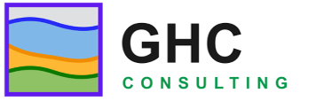
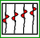

# [Seismic Trace Viewer (STV)](https://donpei.github.io/stv-release)

_A Product of GHC Consulting_

Copyright © 2019-2026 GHC Consulting

Last Revision: October 10, 2026

## Contents

  * System Requirements
  * Downloads
  * Installing
  * Quick Start
  * Preface
  * The Main Window
  * Opening Data
  * The Toolbar
  * The View Menu
  * Monitoring Trace Headers and Samples
  * Snapshots
  * Mouse and Keyboard Shortcuts
  * About SEG-Y
  * About the Programming
  * Acknowledgements
  * Legal
  * References

## System Requirements

STV is a Java application and runs on any platform with a compatible Java runtime. The distribution includes a trimmed Java runtime, so you do not need to install Java separately. The requirements are:

  * A 64-bit operating system: Windows® 10 or later, macOS 11 or later, or a 64-bit Linux distribution.
  * A video display with:
    * 32-bit color
    * A screen resolution of 1280×800 or better. A widescreen monitor works best, because seismic lines are wide.
  * Enough memory to hold the data you want to view. A 500-trace by 2000-sample SEG-Y file is only a few megabytes, but very large 3D volumes are best viewed one line at a time.

The app has been tested on:

  * 64-bit Windows® 10 and 11
  * macOS on Apple silicon and Intel

## Downloads

[Download page](https://www.247foxhosting.com/ghcconsulting/stv/) contains one portable bundle per platform — unzip and run, no installation required.

| Platform | Download |
|---|---|
| Windows 10/11 (64-bit) | `stv_1.0.0_win_app.zip` |
| macOS 11+ (Apple Silicon and Intel) | `stv_1.0.0_mac_app.zip` |
| Linux (64-bit) | `stv_1.0.0_linux_app.zip` |

Each bundle includes a trimmed Java runtime — no Java installation required.

* * *

## Installing

STV is distributed as a `.zip` archive containing the application, a trimmed Java runtime, launch scripts, and this documentation.

### Installing on Windows

  1. Download the latest STV `.zip` archive.
  2. Unzip it to a folder of your choice, for example `C:\apps\stv`.
  3. Double-click the launch script (or its icon ) to start the program.

### Installing on macOS

  1. Download the latest STV `.zip` archive.
  2. Unzip it and drag the `stv` folder to your `Applications` directory, or run it in place.
  3. Double-click the launch script to start the program. The STV icon  appears in the dock while the program runs, and a tray icon is available for quick access.

### Installing on Linux

  1. Download the latest STV `.zip` archive.
  2. Unzip it, make the launch script executable if needed (`chmod +x stv.sh`), and run it.

No installer is required and nothing is written outside the folder you unzipped. To uninstall, simply delete the folder.

* * *

## Quick Start

If instructions bore you, do the following:

  * Start the program.
  * Press **Ctrl+O** (or choose **File > Open Folder**) and pick a folder containing SEG-Y files (`.segy` or `.sgy`).
  * Click a file in the tree on the left. Its traces appear in the display.
  * Drag with **Alt+Shift** held down to zoom into an area; click with **Alt+Shift** to zoom back out.

Read the rest of the documentation to understand what you are looking at.

* * *

## Preface

STV (Seismic Trace Viewer) displays seismic traces stored in SEG-Y files, the standard exchange format of exploration seismology. It is a working tool, not a toy: it reads real field and processed data, shows every trace as a wiggle, and lets you inspect the headers that describe each trace.

The program was written by GHC Consulting, a hydraulic fracturing consultancy, for the unglamorous but essential job of _looking at the data_: checking that a SEG-Y file is what it claims to be, that the headers make sense, that the amplitudes are sane, and that the geometry hangs together before the data goes into processing or interpretation.

STV tries to do one thing well. It does not process, filter, or migrate data. It shows you the traces, quickly and honestly, so you can decide what to do next.

* * *

## The Main Window

To start the program, run the launch script, or double-click its icon . The program opens a window with four major portions:

  * The **menu bar** at the top holds the **File** and **View** menus.
  * The **toolbar** below it holds zoom, pan, snapshot, and settings buttons, plus a **Big Endian** checkbox (see Opening Data).
  * The **file tree** on the left browses the folder you opened. Click a SEG-Y file to load it.
  * The **display panel** on the right shows the seismic traces.

Before any data is loaded, the display shows the STV home panel: a summary of the mouse shortcuts (also listed under Mouse and Keyboard Shortcuts).

The rest of this section explains the menus, toolbar buttons, and dialogs that control the program.

* * *

## Opening Data

### Opening a Folder

Choose **File > Open Folder**  (or press **Ctrl+O**) and select a folder containing seismic data. The folder appears as the root of the file tree on the left. Click any `.segy` or `.sgy` file in the tree to load it; its traces are drawn in the display panel.

The **File** menu also keeps a list of up to 20 recently opened files and folders, so you can jump straight back to yesterday's data.

### Byte Order: the Big Endian Checkbox

The toolbar carries a **Big Endian** checkbox. Classic SEG-Y files store binary values big-endian (most significant byte first), and STV assumes big-endian by default.

If a file loads but the traces look like white noise, or the amplitudes are absurd, the file is probably little-endian (allowed since SEG-Y revision 2.0). Uncheck **Big Endian** and the file is reloaded with the bytes swapped. Checking or unchecking the box reloads the current file immediately, so you can flip it back and forth until the data looks right.

See About SEG-Y for why byte order matters.

* * *

## The Toolbar

The toolbar buttons control the display. Hover over any button for a tooltip.

| Button | Action |
|---|---|
|  | Zoom in, both directions |
|  | Zoom out, both directions |
|  | Zoom in horizontally (more traces across the screen) |
|  | Zoom out horizontally |
|  | Zoom in vertically (stretch the time axis) |
|  | Zoom out vertically |
|  | Pan mode: drag the display to scroll through the data |
|  | Snapshot of the current view to the clipboard |
|  | Snapshot including side labels to the clipboard |
|  | Snapshot of the current view to a PNG file |
|  | Snapshot including side labels to a PNG file |
|  | Toggle the display settings panel |

The display settings panel (toggled by the last button) controls how traces are drawn. Experiment freely; every control redraws the display immediately, and nothing you do there modifies your data file.

* * *

## The View Menu

The **View** menu opens windows that show the numbers behind the wiggles.

**File EBCDIC header**: shows the 3200-byte textual file header as 40 lines of text. This is the human-readable description of the data set: client, line, reel, acquisition parameters, processing history. On old files it is encoded in EBCDIC; STV converts it for display. If this header is blank or garbage, the file may be corrupt or mistyped.

**File binary header**: shows the 400-byte binary file header as named fields: sample interval, samples per trace, data format code, and the other values that apply to every trace in the file. Check the sample interval and trace length here first when a file looks wrong; they are the most common liars.

**Monitor trace header** and **Monitor trace sample** open live monitor dialogs; see the next section.

* * *

## Monitoring Trace Headers and Samples

**Monitor trace header** opens a dialog that follows your cursor: as you move across the display, it shows the 240-byte trace header of the trace under the cursor as named fields — trace sequence number, field record number, source and receiver coordinates, offset, CDP number, and the rest. This is the fastest way to answer "which trace am I looking at, and where was it shot?"

**Monitor trace sample** opens a dialog that shows the actual sample values of the trace under the cursor. Use it to check amplitudes quantitatively instead of eyeballing wiggle heights.

Both dialogs stay open while you work; move the cursor and the numbers update.

* * *

## Snapshots

The four snapshot buttons capture what you see for reports and presentations. Two copy the image to the system clipboard (), ready to paste into a document; two write a PNG file () into the project's image folder, named automatically like `ss2026-10-10-13-26-21.png`.

For each destination you can capture just the trace display, or the display _including side labels_, which adds the annotation panels around the traces. The labeled version is usually the one you want for a figure.

* * *

## Mouse and Keyboard Shortcuts

| Keys | Mouse | Action | 
|------|------|------| 
| Alt | Right click | Select a trace and pop up its menu | 
| Alt + Shift | Drag | Zoom in on the dragged rectangle (release to zoom) | 
| Alt + Shift | Click | Zoom out | 
| Ctrl+O |  | Open a data folder | 
| Ctrl+Q |  | Exit the program | 
 
The same shortcuts are shown on the home panel that appears when STV starts.

* * *

## About SEG-Y

SEG-Y is the standard format for exchanging seismic reflection data, maintained by the Society of Exploration Geophysicists (SEG). It was developed in 1973 for storing single-line seismic data on magnetic tape, and the specification was published in 1975 (Barry et al.). Revisions followed in 2002 (rev 1) and 2017 (rev 2.0), but the skeleton of every SEG-Y file is unchanged:

| Section | Size | Contents |
|---|---|---|
| Textual file header | 3200 bytes | 40 lines of 80 characters: human-readable description of the data set. Originally EBCDIC; rev 1 allows ASCII. |
| Binary file header | 400 bytes | Binary values applying to the whole file: sample interval, samples per trace, data format code, and more. |
| Trace header | 240 bytes | Binary values describing one trace: sequence numbers, shot and receiver coordinates, offset, CDP, and more. |
| Trace data | samples × bytes/sample | The actual amplitude samples, in the format named by the binary header. |

**Sample formats.** The binary header's format code says how each sample is stored: 32-bit IBM floating point (the 1975 original), 32-bit integer, 16-bit integer, IEEE floating point, and — since rev 1 — 8-bit integer, among others. STV reads the common formats; if your file uses an exotic one, the binary header viewer will at least tell you which code it claims.

**Byte order.** Revisions 0 and 1 define all binary values as big-endian: the most significant byte comes first. Revision 2.0 additionally permits little-endian files (flagged in bytes 3297–3300 of the binary header), mostly for I/O performance on modern hardware (Agile Scientific). This is why STV has a **Big Endian** checkbox: when the wiggle looks like noise, the bytes are probably in the other order.

**A note on honesty.** The headers in a SEG-Y file are metadata _about_ the data, written by whoever created the file. They can be wrong — sample intervals get mistyped, coordinate units get confused, EBCDIC headers get left blank. STV shows you both the headers and the traces so you can check one against the other. Trust, but verify.

* * *

## About the Programming

**Language and libraries**: STV is written in Java (currently Java 21) using the Swing GUI toolkit, with the FlatLaf look-and-feel for a consistent modern appearance on Windows, macOS, and Linux (FormDev Software). It has no native code and no required third-party libraries beyond the UI theme, so the same program runs everywhere Java runs.

**Rendering**: traces are rasterized into an off-screen image and painted to the display, which keeps panning and zooming smooth even for large files. Only the visible portion is redrawn when you scroll or zoom.

**File I/O**: SEG-Y files are read directly with a built-in reader that handles the textual header, binary header, trace headers, and the common sample formats, in big- or little-endian byte order. File and path handling uses plain Java string operations, with no external dependencies.

**Known idiosyncrasies**:

  * Very large files take a moment to load; the whole file is read into memory.
  * Exotic SEG-Y revisions (extended textual headers, trace header extensions) are not fully interpreted, though the standard headers display correctly.

* * *

## Acknowledgements

Thanks to the Society of Exploration Geophysicists for maintaining the SEG-Y standard as an open specification, and to the authors of the free software used in building STV:

  * The FlatLaf project for the modern Swing look-and-feel
  * The Project Lombok authors for boilerplate-free Java
  * The USGS for its public SEG-Y format documentation

Any errors in this documentation are the author's own.

* * *

## Legal

**Distribution**: STV is a product of GHC Consulting.

**Disclaimer**: No warranty expressed or implied. Use this software at your own risk.

STV displays seismic data as recorded; it does not verify the correctness of file headers, and header values shown are only as reliable as the files that contain them. STV is a viewing tool, not a substitute for professional geophysical judgment.

* * *

## References

  * Barry, K. M., Cavers, D. A., and Kneale, C. W., "Recommended standards for digital tape formats", _Geophysics_, v. 40, 1975. The original SEG-Y specification.
  * SEG Technical Standards Committee, [SEG-Y revision 2.0](https://library.seg.org/seg-technical-standards), January 2017. The current SEG-Y standard, including little-endian support.
  * U.S. Geological Survey, [Open-File Report 2000-0340: SEG-Y file format description](https://pubs.usgs.gov/of/2000/0340/htmldocs/segy.html), with an annotated example of the 3200-byte textual header and binary header layout.
  * Agile Scientific, ["SEG-Y Rev 2 again: little-endian is legal!"](https://agilescientific.com/blog/2017/3/31/little-endian-is-legal), 2017. A plain-English tour of what changed in SEG-Y revision 2.0.
  * FormDev Software, [FlatLaf — Flat Look and Feel](https://www.formdev.com/flatlaf/), the modern Swing theme used by STV.
